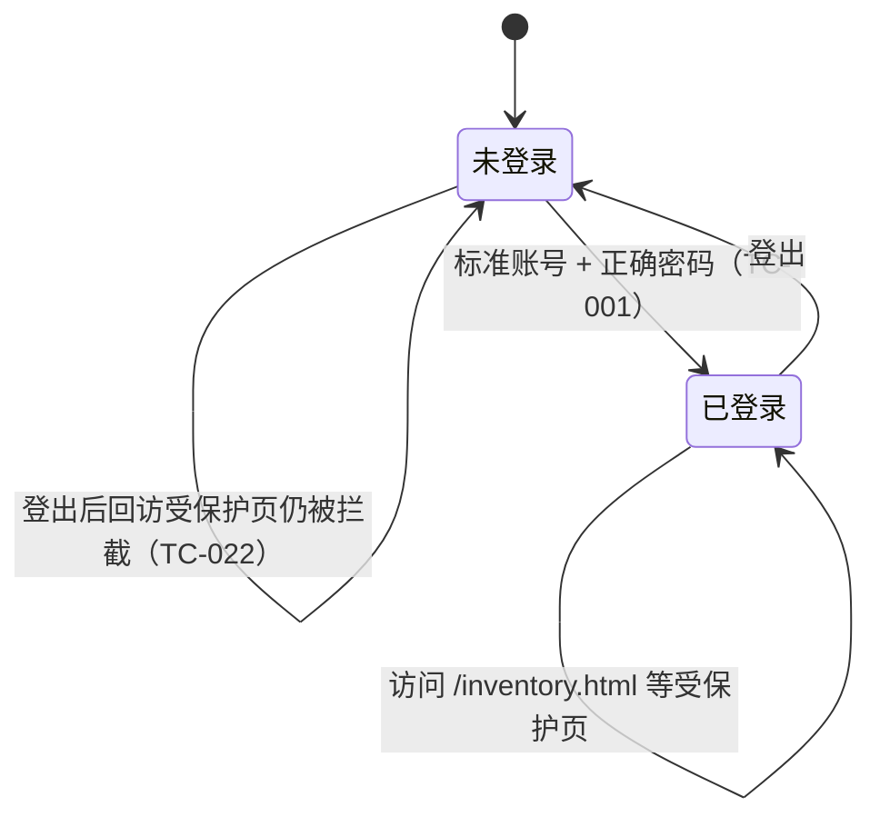
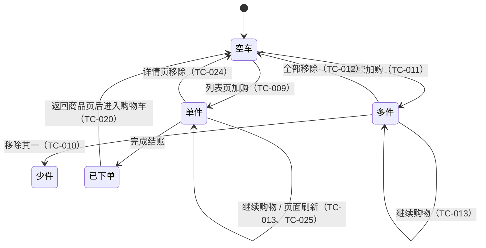
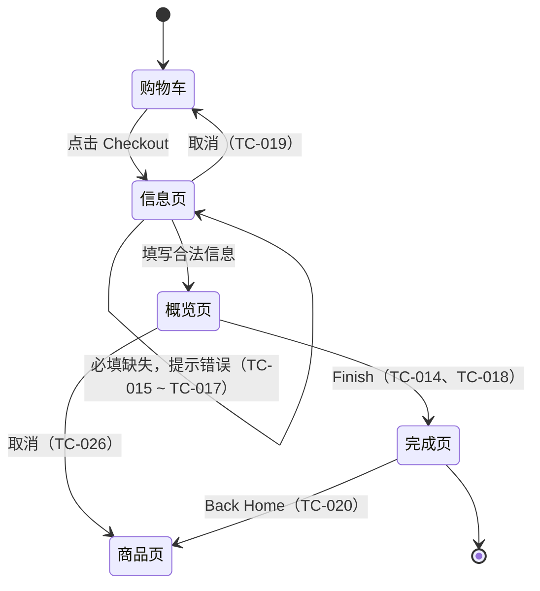
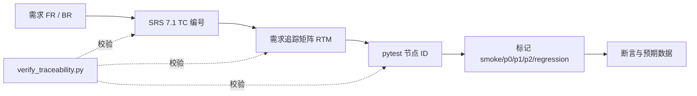

# 用例设计说明

> 解释 26 条 UI 用例“为什么这么设计”：风险从哪来、用哪些方法选取场景、断言为什么这样写、砍掉了哪些组合、维护时改哪里。
> 配套：[需求规格说明书](需求规格说明书.md) · [需求追踪矩阵](需求追踪矩阵.md) · [面试讲解卡](面试讲解卡.md) · [缺陷分析示例](缺陷分析示例.md)

## 1. 设计目标与依据

用例设计不是“把页面点一遍”，而是在有限执行时间内锁定最可能出问题的业务不变量。本项目的输入依据是：

| 依据 | 提供什么 | 位置 |
|---|---|---|
| 需求规格说明书 | BR/FR、验收标准 AC-02/03、26 条用例范围、明确的不覆盖项 | `docs/需求规格说明书.md` §4–§7 |
| 页面真实行为 | 登录失败文案、必填校验文案、排序选项、金额结构、受保护路由 | SauceDemo 演示站实际 DOM |
| 风险判断 | 主链路、鉴权边界、跨页面状态同步、金额计算 | §2 风险模型 |
| 历史缺陷 | 公网抖动、报告证据缺失 | `docs/缺陷分析示例.md` |
| 离线框架测试 | local HTML fixture、BasePage 与 7 个页面对象的行为基线 | `tests_offline/`（22 条，不计入 26 条业务用例） |

设计原则：

1. **主链路必须闭环**：登录 → 加购 → 结账 → 完成页，任一步断裂都阻断发布。
2. **状态优先于样式**：断言 URL、文案、角标、列表内容、金额关系，不断言颜色/布局等易变表现。
3. **组合有取舍**：用等价类 + 边界值压缩组合，不为“看起来全面”堆同构用例。
4. **失败可诊断**：每条用例独立会话，失败时截图、JSON、日志尾部进入同一 `run_id` 归档。

## 2. 风险模型

| 风险域 | 典型失效 | 业务影响 | 覆盖用例 |
|---|---|---|---|
| 登录与会话 | 错误凭证放行、锁定账号可登录、未登录直接访问受保护页 | 账号安全、数据越权 | TC-001 ~ TC-005、TC-021、TC-022 |
| 商品与排序 | 排序方向错误、列表缺项、重复商品 | 用户找不到商品、价格误导 | TC-006 ~ TC-008 |
| 购物车状态 | 角标与列表不一致、移除后残留、刷新丢数据 | 下单数量/金额错误 | TC-009 ~ TC-013、TC-025 |
| 跨页面同步 | 详情页加购后列表角标不同步、价格不一致 | 用户重复操作、信任下降 | TC-023、TC-024 |
| 结账与金额 | 必填校验失效、小计/税/总额关系错误、取消丢购物车 | 错误订单、资损 | TC-014 ~ TC-020、TC-026 |
| 终态清理 | 下单后购物车残留、返回商品页仍显示角标 | 下一单数据污染 | TC-020 |

排序依据：**影响 × 发生概率**。登录门禁与下单闭环属于“发生即阻断”，排 P0；鉴权、金额、状态同步排 P1；可恢复的边界与终态清理排 P2。

## 3. 采用的设计方法

| 方法 | 应用对象 | 产出 |
|---|---|---|
| 等价类划分 | 登录账号状态/密码、结账三个必填项、排序选项 | TC-001 ~ TC-005、TC-015 ~ TC-017 |
| 边界值分析 | 购物车数量 0/1/2/3、空态与角标消失、金额两位小数 | TC-009、TC-012、TC-014、TC-018 |
| 状态迁移 | 会话、购物车、结账流程 | TC-009 ~ TC-014、TC-020 ~ TC-022、TC-026 |
| 场景法 | 主流程、取消/返回等备选流 | TC-014、TC-019、TC-020、TC-026 |
| 错误猜测 | 直接访问受保护 URL、登出后回访、刷新、详情与列表反向操作 | TC-021 ~ TC-025 |
| 不变量校验 | 排序单调性、角标=列表数量、小计=Σ单价、总额=小计+税、跨页价格一致 | TC-006、TC-007、TC-009、TC-018、TC-023 |

### 3.1 等价类划分

**登录**：账号状态分为“标准 / 锁定 / 空”，密码分为“正确 / 错误 / 空”。有效类 1 个，无效类按“站点给出不同错误文案”拆分：

| 组合 | 等价类 | 用例 | 预期 |
|---|---|---|---|
| 标准账号 + 正确密码 | 有效 | TC-001 | 进入商品页 |
| 标准账号 + 错误密码 | 无效：凭证不匹配 | TC-002 | `Username and password do not match`，停留在登录页 |
| 锁定账号 + 正确密码 | 无效：账号状态 | TC-003 | `Sorry, this user has been locked out` |
| 空用户名 + 正确密码 | 无效：必填缺失 | TC-004 | `Username is required` |
| 标准账号 + 空密码 | 无效：必填缺失 | TC-005 | `Password is required` |

不覆盖“空 + 空”和“锁定 + 空密码”：站点按字段顺序优先报必填，两个无效输入叠加不会产生新分支，只会重复验证同一校验逻辑。

**结账必填**：名、姓、邮编三个字段各有“合法 / 空”两类。用 1 条全合法基线（TC-014）加 3 条“每次只空一个”的用例覆盖全部单字段缺失分支，而不是 2³ = 8 种组合。多字段同时为空时文案仍为第一个缺失字段，组合用例的边际收益接近 0。

**排序**：下拉框有 4 个选项。选取两个价格方向（TC-006 升序、TC-007 降序）和名称逆序（TC-006 的后半段），覆盖“数值排序”和“字符串排序”两类逻辑。名称 A-Z 是列表默认态，没有单独用例，见 §7 取舍说明。

### 3.2 边界值分析

| 边界 | 值 | 用例 | 验证点 |
|---|---|---|---|
| 购物车下边界 | 0 | TC-012、TC-020、TC-024 | 无 `cart_item`、无角标元素；从“有”到“无”时角标节点消失而不是显示 0 |
| 购物车最小非空 | 1 | TC-009、TC-023、TC-025 | 角标 `1`、数量 `1`、价格与列表一致 |
| 多件与部分移除 | 2 → 1 | TC-010、TC-013 | 移除一项后剩余项、角标同步递减 |
| 多件累加 | 3 | TC-011 | 角标 `3`、每项数量均为 `1` |
| 金额精度 | 两位小数、±0.01 | TC-014、TC-018 | 总额格式 `Total: $xx.xx`；`total = subtotal + tax` 允许 0.01 舍入误差 |

购物车没有业务上限，因此不构造“6 件上限”用例；风险集中在空态/非空态切换和角标显隐，0/1/2/3 已覆盖。

### 3.3 状态迁移

**会话状态**

关键不变量：**受保护页只能由已登录会话进入**。TC-021 验证“从未登录直接访问”，TC-022 验证“从已登录退回未登录后回访”，覆盖门禁的两个方向，而不是只测登录表单。

**购物车状态**

关键不变量：**角标数 = 购物车条目数，列表页与详情页状态一致，刷新不丢失**。TC-023/TC-024 从两个方向验证详情页与列表页的同步，TC-025 验证无状态操作（刷新）不改变业务状态。

**结账流程**

每个出口都被覆盖：正常完成、信息页取消、概览页取消、完成后返回。取消类用例同时断言“购物车内容仍在”，防止取消逻辑误清空。

### 3.4 场景法与错误猜测

| 场景 | 类型 | 用例 |
|---|---|---|
| 单商品从登录到下单完成 | 主流程 | TC-014 |
| 多商品结账并核对金额 | 主流程 + 金额不变量 | TC-018 |
| 信息页取消回到购物车 | 备选流 | TC-019 |
| 概览页取消回到商品页 | 备选流（站点实际行为） | TC-026 |
| 完成页返回商品页 | 备选流 + 终态清理 | TC-020 |
| 未登录直接拼 URL 访问 | 异常/安全边界 | TC-021 |
| 登出后回访受保护页 | 异常/安全边界 | TC-022 |
| 列表加购 → 详情页移除 → 返回列表 | 错误猜测：跨页反向操作 | TC-024 |
| 购物车刷新 | 错误猜测：无状态操作导致丢失 | TC-025 |

这些场景来自对“用户可能怎么绕过正常路径”的推演：直接输 URL、登出后回退、详情页反向操作、刷新页面。它们比再增加一条“正常加购”更能发现真实缺陷。

## 4. 断言设计（Oracle）

| 断言类型 | 示例 | 为什么可靠 | 避免什么 |
|---|---|---|---|
| URL | `endswith("/inventory.html")`、停留在 `/checkout-step-one.html` | 路由是业务阶段的强信号 | 不依赖页面标题等可改文案 |
| 精确错误文案 | `Username and password do not match` | 文案由 YAML 数据驱动，逐条可比对 | 不用 `assert error` 这类弱断言 |
| 列表内容与顺序 | `prices == sorted(prices)`、`names == sorted(names, reverse=True)` | 验证排序性质而非固定快照 | 不写死完整商品序列，避免商品调整即失败 |
| 角标与数量 | `cart_badge_count() == 3`、`item_quantity() == "1"` | 同时验证汇总状态与明细状态 | 不只验角标，防止“角标对、列表错” |
| 金额关系 | `total = subtotal + tax ± 0.01` | 税率变化不影响用例，只校验不变量 | 不写死税额/总额具体数字 |
| 跨页一致性 | 详情页价格 == 列表页价格 | 防止同一商品在不同页面价格漂移 | 不做像素/样式断言 |
| 空态 | 无 `cart_item`、角标元素不存在 | 覆盖“0”与“元素消失”两种表现 | 不只断言 `count == 0` |

金额类断言统一走 `_amount()` 解析 `$xx.xx`，格式异常会先失败在解析处，错误信息包含原始文本，便于定位。

## 5. 26 条用例设计映射

| TC | 方法 | 设计意图 | 关键断言 |
|---|---|---|---|
| TC-001 | 等价类（有效）+ 场景主流程 | 证明标准账号可进入商品页 | 标题 `Products`、URL `/inventory.html` |
| TC-002 | 等价类（无效：密码） | 凭证错误不放行且提示准确 | 错误文案包含 `do not match`、URL 回到根路径 |
| TC-003 | 等价类（无效：账号状态） | 锁定账号即使密码正确也拒绝 | 错误文案包含 `locked out` |
| TC-004 | 等价类（必填）+ 参数化 | 空用户名触发必填校验 | 与 YAML `expected_error` 完全一致 |
| TC-005 | 等价类（必填）+ 参数化 | 空密码触发必填校验 | 与 YAML `expected_error` 完全一致 |
| TC-006 | 排序不变量 | 数值升序 + 字符串逆序都能正确排序 | 6 个价格非递减；名称逆序排列 |
| TC-007 | 排序不变量 | 价格降序不依赖实现细节 | 价格非递增 |
| TC-008 | 数据完整性 | 列表无缺项、无重复、无异常价格 | 名称/价格各 6 个、名称唯一、价格 > 0 |
| TC-009 | 状态迁移 0→1 + 边界 | 加购后角标、明细、价格三者一致 | 角标 1、名称列表、数量 `1`、价格等于列表价 |
| TC-010 | 状态迁移 2→1 + 部分移除 | 移除一项不影响另一项 | 剩余名称、角标 1、角标仍可见 |
| TC-011 | 状态迁移 0→3 | 多商品累加不串行、数量不合并 | 角标 3、名称顺序、每项数量 1 |
| TC-012 | 状态迁移 N→0 + 空态边界 | 全部移除后进入空态 | 无 `cart_item`、角标 0、角标节点消失 |
| TC-013 | 场景备选流 | 继续购物不清空已有商品 | 返回列表后角标仍为 2 |
| TC-014 | 场景主流程 + 金额/完成态 | 单商品端到端闭环 | 商品名、小计匹配单价、总额格式、支付/配送信息非空、完成页文案与 URL |
| TC-015 | 等价类（缺名）+ 参数化 | 单字段缺失被拦截 | YAML 预期文案、停留信息页 |
| TC-016 | 等价类（缺姓）+ 参数化 | 单字段缺失被拦截 | YAML 预期文案、停留信息页 |
| TC-017 | 等价类（缺邮编）+ 参数化 | 单字段缺失被拦截 | YAML 预期文案、停留信息页 |
| TC-018 | 金额不变量 + 多商品 | 小计等于单价之和、总额等于小计加税 | 商品顺序、`subtotal == Σprice`、`total ≈ subtotal + tax` |
| TC-019 | 场景备选流（信息页取消） | 取消不丢购物车 | 回到购物车、商品仍在、角标 1 |
| TC-020 | 终态清理 + 场景返回 | 下单后购物车被清空 | 列表角标 0、购物车空、无 `cart_item` |
| TC-021 | 错误猜测/安全边界 | 未登录不能直达受保护页 | 精确拦截文案、URL 回到登录页 |
| TC-022 | 状态迁移（登录→登出）+ 安全边界 | 登出后旧 URL 不能访问 | 登录按钮可见、回访被拦截 |
| TC-023 | 跨页同步（列表→详情） | 详情页加购同步到列表 | 详情页价格一致、角标 1、返回后角标 1 且显示 Remove |
| TC-024 | 跨页同步（详情→列表，反向） | 详情页移除同步清空列表状态 | 详情页角标 0、返回后角标 0 且显示 Add |
| TC-025 | 错误猜测（刷新） | 刷新不丢业务状态 | 商品列表、数量、角标刷新后保持 |
| TC-026 | 场景备选流（概览页取消） | 取消路径符合站点实际行为且清空购物车 | 回到商品页、角标 1、购物车仍有商品 |

## 6. 优先级与执行集

| 优先级 | 数量 | 判定标准 | 用例 |
|---|---|---|---|
| P0 | 4 | 断裂即阻断主链路或登录门禁 | TC-001、TC-002、TC-009、TC-014 |
| P1 | 16 | 关键分支、鉴权、金额、状态同步 | TC-003 ~ TC-007、TC-010、TC-011、TC-015 ~ TC-019、TC-021 ~ TC-023、TC-026 |
| P2 | 6 | 可恢复边界、终态清理、信息完整性 | TC-008、TC-012、TC-013、TC-020、TC-024、TC-025 |

冒烟集 = P0 的 4 条（`pytest -m smoke`），用于提交前与 PR 门禁；全量回归 26 条用于合并前、定时任务和版本验证。优先级与标记由 `tools/verify_traceability.py` 校验，避免文档、标记、用例数量漂移。

## 7. 参数化与取舍

### 7.1 参数化

23 个测试函数生成 26 条用例：

| 参数化点 | 函数 | 组数 | 数据文件 |
|---|---|---|---|
| 登录空字段 | `test_login_with_empty_field_shows_error` | 2（空用户名、空密码） | `testdata/login_cases.yaml` |
| 结账必填 | `test_checkout_required_field_validation` | 3（缺名、缺姓、缺邮编） | `testdata/checkout_cases.yaml` |

选择参数化而不是拆成 5 个函数的理由：流程、断言、失败诊断完全同构，只有输入和预期文案不同；YAML 让数据可以被非开发角色审阅。每条参数用例仍由 fixture 创建独立浏览器会话，因此节点 ID 独立、失败互不影响、报告可逐条追溯。

### 7.2 明确取舍

| 未做 | 原因 | 风险兜底 |
|---|---|---|
| 结账 2³ 全组合 | 多字段同时为空重复验证同一校验顺序，边际收益低 | 每个字段至少一次缺失 + 全合法基线 |
| 名称 A-Z 单独用例 | 默认排序，商品清单固定；再测一次与 TC-006 高度同构 | TC-006 覆盖 Z-A，TC-008 校验列表数量与唯一性 |
| 购物车 6 件上限 | 站点无业务上限，风险集中在空/非空切换 | 0/1/2/3 数量边界 |
| 税额精确值 | 税率可能随站点调整，写死会产生假失败 | 只校验 `total = subtotal + tax` 不变量 |
| 排序跨页面保持 | 需要多页面往返，超出本期风险范围（SRS §7.3） | 后续迭代补充 |
| 支付失败/历史订单 | 演示站无真实支付与订单持久化 | 明确列入不覆盖项 |
| 并发与并行执行 | 共享演示站，先保证会话隔离与不污染共享状态（FR-SEC-02） | 串行执行，独立会话 |

这些取舍写入 SRS §7.3，验收时不把“未覆盖”当作遗漏，而是当作已声明的范围边界。

## 8. 可维护性

| 变化 | 修改位置 | 不需要改 |
|---|---|---|
| 站点改版导致定位变化 | `config/locators/<page>.yaml` | 用例、页面对象 |
| 错误文案/测试数据变化 | `testdata/*.yaml` | 测试函数 |
| 新增环境/地址 | `config/env/<name>.yaml` | 用例 |
| 新增同类校验数据 | YAML 追加一组 + SRS/RTM 增行 | 测试逻辑 |
| 新增页面能力 | 对应 Page Object + 定位器 YAML + 用例 | 其他页面 |

硬约束由校验脚本静态检查：`tests/` 不出现定位器字面量，`pages/` 与 `core/` 不写业务断言，页面变化优先只改 YAML。

修改 `BasePage` 或页面对象后，先跑离线套件（`pytest -c pytest-offline.ini -v`，22 条，约 14s，不访问公网），再跑 26 条业务用例。这样站点抖动时仍能区分“框架改坏了”和“公网不可用”。

## 9. 与追溯体系的关系

新增或调整用例时必须同步：

1. SRS §7.1 增加/修改 TC 行；
2. RTM 增加映射行（需求 → 节点 → 标记 → 断言）；
3. 测试模块保留 `pytestmark = pytest.mark.regression`，按风险补 P0/P1/P2；
4. 参数化数据放 `testdata/`，不写进测试函数；
5. 更新 README、SRS、RTM 与校验脚本中的用例计数；
6. 运行 `python tools/verify_traceability.py`，23 项全部通过才算完成。

任何一项缺失，校验脚本会让 CI 在 lint/单测阶段失败，从机制上防止“加了用例但文档没跟上”。

## 10. 设计评审清单

- [ ] 场景对应至少一条需求，且有明确风险来源。
- [ ] 断言验证业务状态，不依赖样式、动画或固定快照。
- [ ] 错误路径断言精确文案，而不是“出现错误”。
- [ ] 状态类用例同时校验汇总（角标）与明细（列表/数量/价格）。
- [ ] 金额类用例校验关系与格式，不写死税额。
- [ ] 参数化只用于同构流程，数据外置到 YAML。
- [ ] 新增用例后计数、标记、RTM 与校验脚本同步。
- [ ] 单条用例可独立运行，失败产物落入本次 `run_id` 归档。
