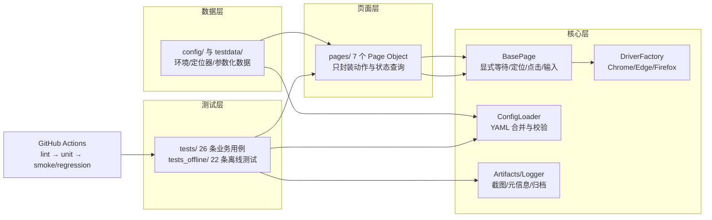
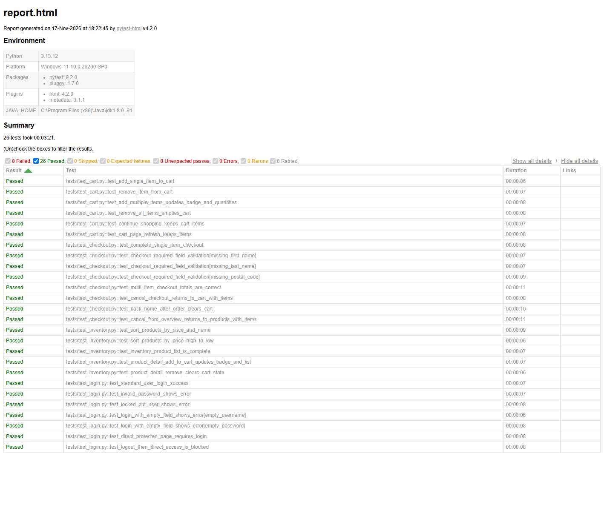
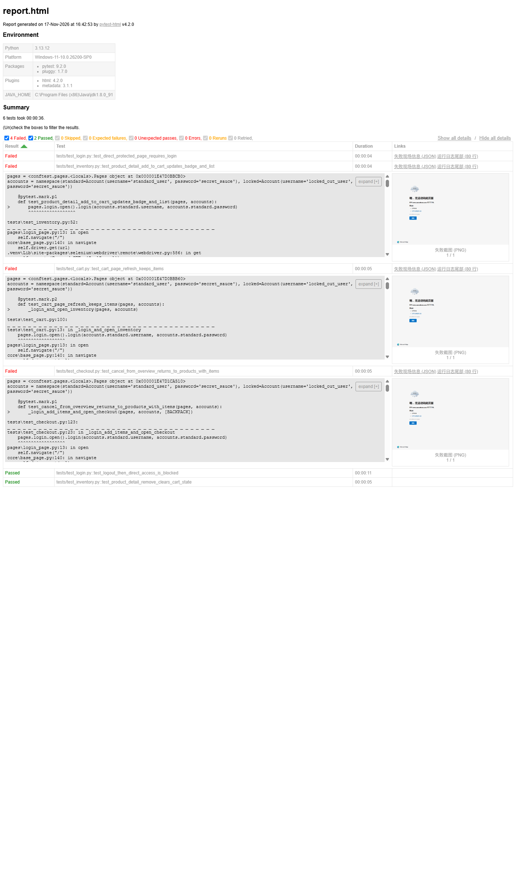

# 面试讲解卡

> 一页掌握：项目解决什么问题、怎么分层、做了哪些取舍、有哪些量化证据。
> 配套：[README](../README.md) · [需求规格说明书](需求规格说明书.md) · [用例设计说明](用例设计说明.md) · [缺陷分析示例](缺陷分析示例.md)

## 1. 30 秒版本

这是一个面向 **SauceDemo 电商主链路** 的 UI 自动化工程：Selenium + pytest + YAML + Page Object，覆盖登录、商品列表与排序、购物车、结账、完成页与会话边界，共 **26 条业务用例 / 7 个页面对象 / 32 条配置单测 + 22 条离线页面对象测试**。

它不只“能跑通”：定位器与数据外置、失败截图/现场 JSON/日志尾部内嵌 HTML 报告、SRS → RTM → pytest 节点逐条可追溯、CI 双浏览器矩阵、ruff 质量门禁，并且把真实遇到的网络抖动与报告插件缺陷写成了可复盘的分析文档。

## 2. 架构与分层



| 层 | 职责 | 硬约束 |
|---|---|---|
| `tests/` | 业务动作、预期断言、标记 | 不出现定位器字面量、不调用 `find_element` |
| `pages/` | 页面动作与状态查询 | 不写断言；不直接 `sleep` |
| `core/` | 定位解析、显式等待、驱动、配置、产物 | 对页面无业务假设 |
| `config/` `testdata/` | 环境、定位器、参数化数据 | 改版优先只改 YAML |

约束由 `tools/verify_traceability.py` 静态检查：`core/`、`pages/` 无断言，`tests/` 无定位器字面量。

## 3. 五个关键取舍

| 决策 | 理由 | 代价/边界 |
|---|---|---|
| **YAML 外置定位器与数据** | 站点改版只改配置；同一套用例可切环境 | 多一层加载与校验成本 |
| **只用显式等待，隐式等待为 0** | 等待具体业务状态，避免隐式/显式叠加导致超时不可预测 | 每个动作都要定义“完成信号” |
| **不引入用例重试** | 重试会掩盖真实缺陷；公网抖动应保留证据、隔离复跑 | 演示站抖动时需要人工复跑 |
| **失败证据“双份”** | HTML 报告内嵌截图/JSON/日志，磁盘按 `run_id` 归档 | 报告体积增大；产物需脱敏与短保留 |
| **优先级按业务风险划分** | P0 只留登录与下单主链路（4 条冒烟），P1 覆盖分支与安全边界 | 用例数受控，不追求“全覆盖” |

## 4. 量化证据

| 项目 | 结果 |
|---|---|
| 本机 Edge 157（无头） | **26/26 通过，200.78s** |
| 本机 Chrome 158（有头实跑） | **26/26 通过，362.14s** |
| 托管 CI run #10 | Chrome regression **49s**、Firefox regression **151s**，26 条全量通过 |
| 托管 CI run #12 | 离线 22 条 **50s**；Chrome/Firefox smoke 各 31s/33s，均通过 |
| 冒烟集 | 4 条，33.44s |
| 框架单测 / 静态检查 | 32 条配置单测 + 22 条离线页面对象测试通过；ruff 0 告警 |
| 离线测试耗时 | 约 14s/轮，不访问公网；连续 3 轮 22/22 |
| 需求追踪 | 23/23 项自动校验通过，26 条用例逐条映射 |

CI job 明细（run #10，[运行页](https://github.com/DYQ1104/saucedemo-ui-tests/actions/runs/44065258364)）：

| Job | 耗时 | 结果 |
|---|---|---|
| Ruff lint | 9s | 通过 |
| Unit / py3.13 | 13s | 通过 |
| Unit / py3.11 | 9s | 通过 |
| Regression / chrome | 49s | 26 条通过 |
| Regression / firefox | 151s | 26 条通过 |

离线 job 托管运行（run #12，[运行页](https://github.com/DYQ1104/saucedemo-ui-tests/actions/runs/44275101193)）：

| Job | 耗时 | 结果 |
|---|---|---|
| Ruff lint | 16s | 通过 |
| Unit / py3.13 | 12s | 通过 |
| Unit / py3.11 | 14s | 通过 |
| Offline page-object | 50s | 22 条通过 |
| Smoke / chrome | 31s | 通过 |
| Smoke / firefox | 33s | 通过 |

> 当前环境无法直接打开 github.com 页面，因此 CI 证据以上表（GitHub API 读取）和 README 徽章呈现；报告截图为本机真实产物。2026-11-18 新增离线 `offline` job（22 条，Chrome 无头），本地连续 3 轮 22/22，托管 run #12 亦 22 条通过。

### 通过报告



### 失败现场（内嵌截图、JSON 元信息、日志尾部）



> 图中账号为 SauceDemo 公开演示账号，不包含任何真实凭据。

## 5. 三分钟演示脚本

```bash
# 1. 30s：静态校验，说明“文档/标记/用例/需求”如何保持一致
python tools/verify_traceability.py

# 2. 40s：冒烟 4 条，展示报告结构与环境信息
pytest -m smoke -v

# 3. 80s：直接打开已归档的真实失败报告，展示内嵌截图/JSON/日志与 run_id 归档
#    （如需现场演示，可临时把某条断言改为 False 后单独运行，再还原代码）
#    失败现场：reports/runs/new-cases-20261117/report.html

# 4. 30s：展示 CI run #10 的双浏览器矩阵与 ruff/unit 门禁
```

讲解顺序建议：**业务链路 → 分层与约束 → 失败诊断 → CI 与量化结果 → 取舍与边界**。

## 6. 常见追问与回答要点

| 追问 | 回答要点 |
|---|---|
| 为什么不用重试？ | 重试会掩盖真实缺陷；公网抖动已通过失败证据与整轮复跑区分，缺陷分析中有完整记录 |
| 为什么不用 Allure？ | 当前 pytest-html 已内嵌截图/元信息/日志，满足诊断闭环；趋势与历史对比是下一步需求，不提前引入复杂度 |
| 为什么不做并行？ | SauceDemo 是共享演示站，先保证会话隔离与不污染共享状态；并行需先解决账号与数据隔离 |
| 怎么保证用例不是“写死的”？ | 定位器/数据 YAML 外置；断言基于业务状态（URL、金额、角标、列表）；参数化覆盖空字段三类 |
| 怎么证明覆盖了需求？ | SRS → RTM → pytest 节点 → 标记 → 断言五级映射，脚本自动校验 23 项，缺一条即失败 |
| 最大的坑是什么？ | 报告插件钩子顺序：证据必须在 `makereport` 的 call 阶段、浏览器销毁前写入；见缺陷分析 DEF-03 |

## 7. 已知边界

- 本机未安装 Firefox；Firefox 26 条全量由 CI 覆盖。
- 排序结果跨页面保持、历史订单、支付失败分支未覆盖（SRS 7.3 已声明）。
- 日志轮转、Allure 趋势、GitHub Pages 展示属于后续迭代，不影响本期闭环。
